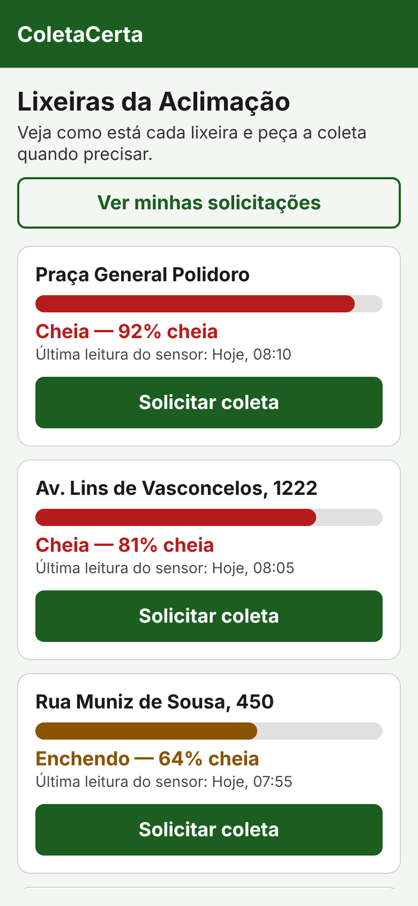
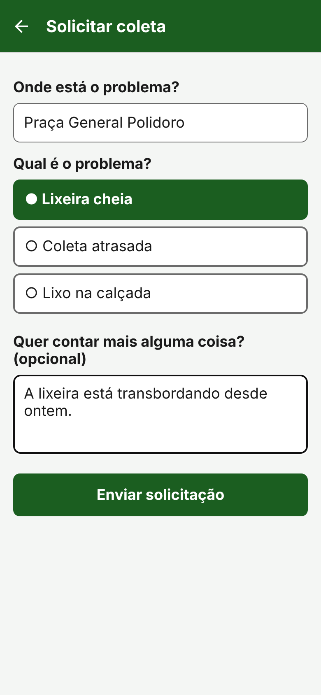
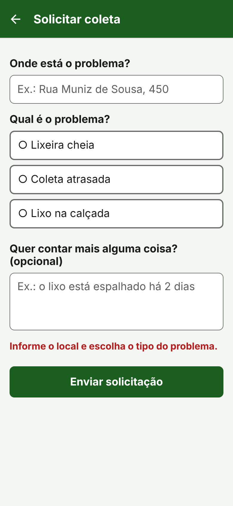
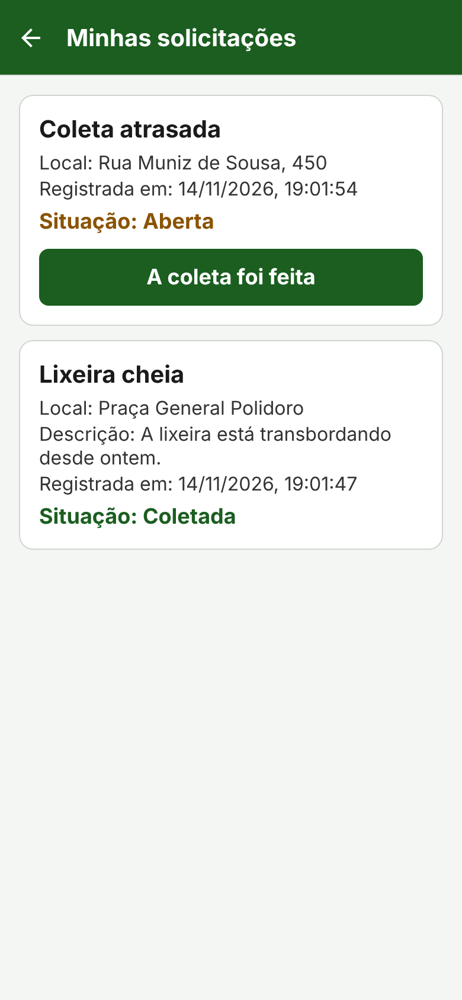

# ColetaCerta — App (Mobile Development & IOT)

Global Solution 2026.2 — CitizenTech — FIAP — Engenharia de Software (3º ano)

## Ficha da CitizenTech

| Campo | Resposta |
| --- | --- |
| **Nome da CitizenTech** | ColetaCerta |
| **Cidade e bairro** | São Paulo – SP, bairro da Aclimação |
| **Cidadão beneficiado** | Morador do bairro que convive com lixeiras cheias e coleta atrasada perto de casa |
| **Problema, em uma frase** | O morador vê a lixeira da rua transbordando e não tem um jeito simples de avisar e acompanhar o pedido de coleta. |
| **Como funciona** | Um sensor mede o quanto cada lixeira está cheia. No app, o morador consulta as lixeiras do bairro, registra uma solicitação de coleta em poucos toques e acompanha a situação do pedido. |
| **O que cada parte faz** | **App (Mobile):** consulta das lixeiras, registro e acompanhamento das solicitações. **Sensor (Physical Computing):** ESP32 mede o nível da lixeira. **Segurança (Cybersecurity):** protege os dados pessoais enviados pelo cidadão. **IA/ML:** analisa as reclamações públicas de coleta do SP156. |
| **Indicador de impacto** | Quantidade de solicitações registradas e quantas foram marcadas como "Coletada" no bairro |
| **ODS conectados** | **ODS 11** (Cidades e comunidades sustentáveis): melhora a gestão de resíduos do bairro. **ODS 3** (Saúde e bem-estar): menos lixo acumulado, menos risco de doenças. |

## Integrantes

| Nome | RM |
| --- | --- |
| Rodrigo Leme | 550266 |
| Thamiris Almeida | 559155 |
| Dayana Ticona | 558023 |
| Werbeth Nunes | 559067 |
| Larissa Biusse | 564068 |

## Vídeo do app rodando 

https://youtube.com/shorts/g67uAk5qDLE?feature=share

## O que o app faz

A jornada principal do cidadão tem 3 passos, um em cada tela:

1. **Consultar** — a tela inicial lista as lixeiras do bairro e mostra o quanto cada uma está cheia (texto, porcentagem e barra).
2. **Registrar** — ao tocar em "Solicitar coleta", o local já vem preenchido. O morador escolhe o tipo do problema e envia.
3. **Acompanhar** — a tela "Minhas solicitações" mostra os pedidos salvos e permite confirmar quando a coleta foi feita.

## Prints das telas

| 1. Lixeiras (consulta) | 2. Solicitar coleta (registro) |
| --- | --- |
|  |  |

| 3. Validação do formulário | 4. Minhas solicitações (acompanhamento) |
| --- | --- |
|  |  |

Os prints foram tirados com o app rodando no navegador (`npm run web`), em tamanho de tela de celular.

## Como rodar o app

Pré-requisito: [Node.js](https://nodejs.org) instalado (versão LTS).

```bash
npm install
```

```bash
npx expo start
```

Depois disso:

- **No celular:** abra o app **Expo Go** e leia o QR Code que aparece no terminal.
- **No navegador:** aperte a tecla `w` no terminal (ou rode `npm run web`).

## Tecnologias usadas

| Item pedido | Onde está no projeto |
| --- | --- |
| React Native com TypeScript (Expo) | Todo o projeto |
| Expo Router (telas e navegação) | `src/app/` — `_layout.tsx` (navegação em pilha), `index.tsx`, `solicitar.tsx`, `solicitacoes.tsx` |
| Consumo de dados (mock) | `src/services/lixeiras.ts` lê `src/mocks/lixeiras.json` |
| Banco de dados (SQLite) | `src/database/banco.ts` — cria a tabela, salva, lista e atualiza as solicitações |

## Estrutura de pastas

```
src/
  app/                  Telas (cada arquivo é uma rota do Expo Router)
    _layout.tsx         Navegação em pilha e cabeçalho
    index.tsx           Tela 1: lixeiras do bairro
    solicitar.tsx       Tela 2: formulário de solicitação
    solicitacoes.tsx    Tela 3: minhas solicitações
  database/
    banco.ts            Banco de dados SQLite (expo-sqlite)
  services/
    lixeiras.ts         Consumo dos dados das lixeiras (mock)
  mocks/
    lixeiras.json       Dados simulados das lixeiras
docs/prints/            Prints das telas usados neste README
prompts.md              Prompts de IA usados no desenvolvimento
```

## Acessibilidade

- Letras grandes (16 a 24) e bom contraste entre texto e fundo.
- Botões com no mínimo 48 de altura, fáceis de tocar.
- A situação da lixeira aparece em **texto** ("Cheia", "Enchendo", "Normal"), não só pela cor.
- Botões, campos e opções têm `accessibilityLabel` e `accessibilityRole` para leitores de tela (TalkBack / VoiceOver).
- Linguagem simples, sem termos técnicos.

## Dados utilizados

- **Lixeiras:** dados **simulados** (arquivo `src/mocks/lixeiras.json`), criados pela equipe para representar a leitura do sensor de nível de cada lixeira. Os endereços são ruas reais do bairro da Aclimação, mas os níveis e horários são fictícios.
- **Solicitações:** ficam salvas apenas no celular do usuário (SQLite). O app não pede nenhum dado pessoal.
